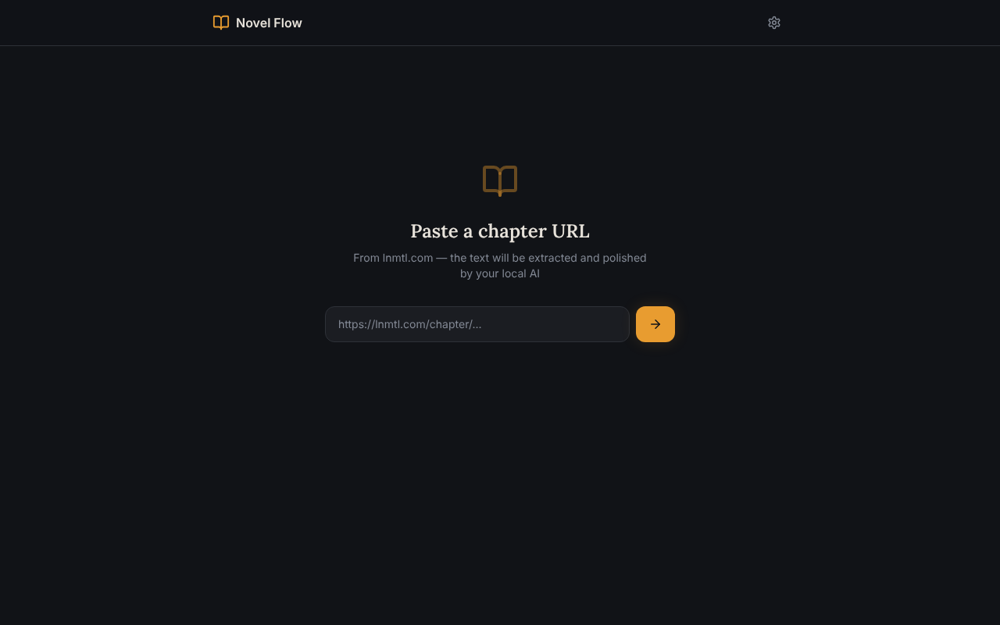

# Novel Flow

**A reader app that turns machine-translated Chinese web novels into clean, natural English using a local AI model.**



Machine-translated web novels are readable, but barely: broken grammar, odd word order, names that change mid-paragraph. Novel Flow fetches a chapter, sends the raw text to a language model, and streams back a polished version in a distraction-free reader. By default it runs entirely on your own PC with [Ollama](https://ollama.com), so nothing leaves your machine and it costs nothing to use.

## Features

- **Paste a chapter URL** from lnmtl.com and the text is extracted automatically
- **Two AI backends:** Ollama running locally (private, free) or Google Gemini (faster, free tier)
- **Streaming output:** text appears as it is generated instead of after the whole chapter
- **Reader comforts:** dark and light themes, adjustable font size, previous/next chapter navigation
- **Installable PWA:** add it to your phone's home screen and read from anywhere over Tailscale

## Tech stack

| Layer | Tools |
|---|---|
| Frontend | React, TypeScript, Vite, Tailwind CSS, shadcn/ui |
| AI | Ollama (Gemma 3) or Google Gemini API |
| Networking | local-cors-proxy, Tailscale for phone access |
| Testing | Vitest |

## How it works

```
Phone or browser
      │
      ▼
React PWA ──► local CORS proxy (port 8010) ──► lnmtl.com chapter
      │
      ▼
Ollama (port 11434) or Gemini API
      │
      ▼
Polished English, streamed into the reader
```

The browser cannot fetch lnmtl.com directly because of CORS, so a small proxy on the PC fetches the page and the app extracts the chapter text from it. The text is then sent to the selected model with instructions to fix grammar and readability while keeping names and meaning intact.

## Getting started

**Requirements:** [Node.js](https://nodejs.org) (LTS), [Ollama](https://ollama.com), and optionally [Tailscale](https://tailscale.com) for phone access.

```bash
git clone https://github.com/wzuri07/novel-flow.git
cd novel-flow
npm install
npm install -g local-cors-proxy

# Pick a model that fits your RAM
ollama pull gemma3:12b   # better quality, 16 GB+ RAM
ollama pull gemma3:4b    # faster, 8 GB RAM
```

On Windows, double-click **`novel-reader-start.bat`** to start Ollama, the proxy and the app in one go. On other systems, run each in its own terminal:

```bash
OLLAMA_ORIGINS=* OLLAMA_HOST=0.0.0.0:11434 ollama serve
lcp --proxyUrl https://lnmtl.com --port 8010 --proxyPartial proxy
npm run dev
```

Then open <http://localhost:8080>.

### Reading on your phone

1. Install Tailscale on your PC and phone and sign in with the same account.
2. Open `http://<your-PC's-Tailscale-IP>:8080` on the phone.
3. Use **Add to Home Screen** to install it as an app.

### Settings

Open the gear icon in the top-right corner:

| Setting | Default | Purpose |
|---|---|---|
| AI provider | Ollama | Switch between Ollama and Gemini |
| Ollama API URL | `http://100.x.x.x:11434` | Where your Ollama server is running |
| Model name | `gemma3:12b` | Any model you have pulled |
| CORS proxy URL | `http://100.x.x.x:8010/proxy` | The proxy that fetches chapters |
| Gemini API key | empty | Free key from [Google AI Studio](https://aistudio.google.com) |

## Scripts

| Command | What it does |
|---|---|
| `npm run dev` | Start the development server on port 8080 |
| `npm run build` | Production build |
| `npm test` | Run the test suite |
| `npm run deploy` | Build and publish the UI to GitHub Pages |

## Notes

- Personal project for reading; the PC must be running for chapters to load.
- The GitHub Pages build only hosts the interface. The proxy and Ollama still run on your PC.
- The initial UI was scaffolded with [Lovable](https://lovable.dev).
